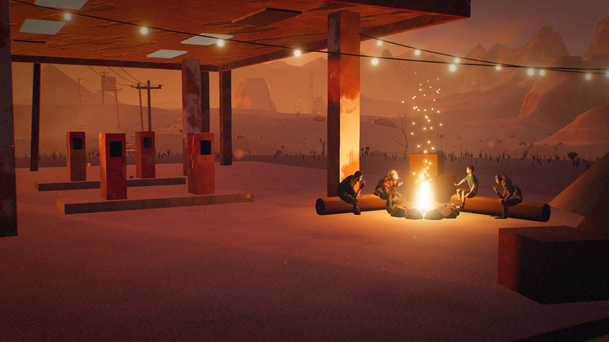
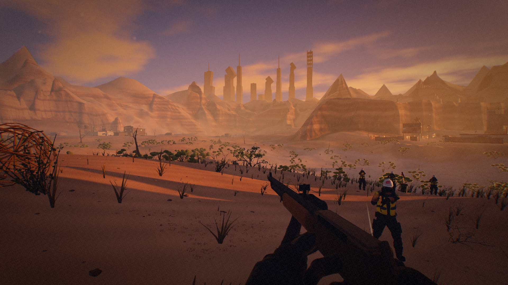

# Bunker Busters

**They built bunkers. You brought lockpicks.**

A free first-person heist game. The founders of the tech elite sealed themselves into doomsday bunkers and left everyone else outside. Scout their bunkers across a desert wasteland, get past their half-broken security and Kade's contractors, and bring the water back to camp.



**[Play in your browser](https://bunker-busters.netlify.app/play/)** · **[Download for Windows or Linux](https://bunker-busters.netlify.app/#get)** · [All releases](https://github.com/L0nE-F0x/Bunker-Busters/releases)

- Eight bunkers, each with its own defences and more than one way in
- A fully voiced story across eight acts
- Lockpicking, circuits, keypads and hacking
- Wolves, dust storms and a day-night cycle in an open desert
- Keyboard and mouse or a gamepad, every key rebindable



## Get the game

| Where | How |
|---|---|
| **Browser** | [bunker-busters.netlify.app/play](https://bunker-busters.netlify.app/play/). Nothing to install. Best in Chrome or Edge. |
| **Phone** | Open the same link and use *Install app*: it plays full screen and offline. |
| **Windows 10/11** (64-bit) | [`BunkerBusters-windows-x64-setup.exe`](https://github.com/L0nE-F0x/Bunker-Busters/releases/latest/download/BunkerBusters-windows-x64-setup.exe). The installer isn't code-signed yet, so SmartScreen may stop it: choose *More info → Run anyway*. |
| **Arch, Omarchy and most distros** | [`BunkerBusters-linux-x86_64.tar.gz`](https://github.com/L0nE-F0x/Bunker-Busters/releases/latest/download/BunkerBusters-linux-x86_64.tar.gz): unpack it and run `./install.sh` (needs WebKitGTK 4.1, e.g. `sudo pacman -S webkit2gtk-4.1`). |
| **Debian, Ubuntu** | [`BunkerBusters-linux-amd64.deb`](https://github.com/L0nE-F0x/Bunker-Busters/releases/latest/download/BunkerBusters-linux-amd64.deb) |
| **Any Linux** | [`BunkerBusters-linux-x86_64.AppImage`](https://github.com/L0nE-F0x/Bunker-Busters/releases/latest/download/BunkerBusters-linux-x86_64.AppImage): make it executable and run it. Slower than the tarball. |

The Windows and Linux apps update themselves: when a new version is out, the title screen offers it.

### What you need

- **Graphics:** a dedicated GPU runs it best. Integrated graphics are fine on the Low or Medium preset. In the browser it uses WebGPU where the browser has it and WebGL2 everywhere else.
- **Windows:** Windows 10 or 11, 64-bit. The installer adds Microsoft's WebView2 if it's missing (it needs a connection for that).
- **Linux:** x86-64. The tarball and the .deb use your system's WebKitGTK 4.1; the AppImage brings its own. On laptops with an NVIDIA GPU the app renders on the NVIDIA card by itself (set `BB_GPU=integrated` to stop it).
- **Disk:** about 100 MB for the app, 200 MB for the AppImage.

### Controls

WASD move · mouse look · Shift sprint · C crouch · Space jump · E use · L torch · 1–3 items · Tab kit · M map · Esc pause. Every key can be rebound, and the whole game, menus included, plays on a gamepad.

### Your saves

Saves stay on your computer: in the browser's storage for the browser version, and for the apps in `%LOCALAPPDATA%\dev.bunkerbusters.game` (Windows) or `~/.local/share/dev.bunkerbusters.game` (Linux). Uninstalling keeps them; the Windows uninstaller deletes them only if you tick *Delete the application data*.

## Found a bug?

[Open a bug report](https://github.com/L0nE-F0x/Bunker-Busters/issues/new?template=bug_report.yml). Say which version you have (bottom left of the title screen), where you play, and what happened; a screenshot helps a lot. Ideas are welcome too: [suggest something](https://github.com/L0nE-F0x/Bunker-Busters/issues/new?template=feature_request.yml).

## Licences

The game's code is under the [MIT licence](LICENSE). The character and animal models (`public/models/`, `Assets/`) and the voice clips (`public/voice/`) aren't covered by it: all rights reserved.

Bunker Busters uses open-source libraries, fonts and tools: [`public/licenses.txt`](public/licenses.txt) lists them all with their licences (also at [bunker-busters.netlify.app/licenses.txt](https://bunker-busters.netlify.app/licenses.txt) and next to the installed app).

---

## For developers

Three.js r187 (WebGPU/WebGL2, TSL shaders), Rapier physics, Vite and TypeScript, with a Tauri 2 desktop shell. The world, the buildings and the props are generated in code; the people and animals are rigged models, and the voices are pre-rendered.

### Play in the browser (dev)

```bash
npm install
npm run dev          # http://localhost:5173  (site at /, game at /play/)
npm run build        # production bundle → dist/
```

The web build deploys to Netlify as-is (`netlify.toml`: `npm run build` → `dist/`). The renderer uses WebGPU where it works and falls back to WebGL2 automatically. The title screen shows which backend is active.

### Website

`index.html` is the marketing/download page (site root). `play/index.html` is the browser build of the game. Netlify deploys both from `main` (`netlify.toml`). The download buttons link to fixed asset names on the latest GitHub Release.

### Desktop app (Tauri)

The same game in a native window (WebKitGTK on Linux, WebView2 on Windows). On hybrid-GPU Linux laptops the app automatically renders on the NVIDIA dGPU (PRIME offload via XWayland). Set `BB_GPU=integrated` to opt out.

```bash
npm run desktop           # dev window
npm run desktop:install   # optimised build + install to ~/.local (app launcher entry)
scripts/install-linux.sh --uninstall
```

Needs Rust and, on Linux, `webkit2gtk-4.1`.

### Releasing

```bash
# add a "## vX.Y.Z" section to CHANGELOG.md, commit, then:
scripts/release.sh patch            # bump everywhere, check the build, commit, tag, push
scripts/release.sh patch --dry-run  # the same without committing anything
```

`.github/workflows/release.yml` builds Linux (tar.gz for Omarchy/Arch, AppImage, .deb) and Windows (NSIS installer), signs them for the in-app updater and publishes the release once every platform has built. `.github/workflows/smoke.yml` then installs each download on fresh Windows and Ubuntu machines, starts the game, checks it reaches the title screen, uninstalls it and uploads screenshots; run it by hand with `source = build` to try a branch before releasing.

`node scripts/licenses.mjs` regenerates `public/licenses.txt` from the lockfiles (`release.sh` does it for you).

### Docs

- `BUNKER_BUSTERS_SPEC.md`: game design spec
- `NOTES.md`: dev log: what works, what's stubbed, GPU/backend findings, next steps
- `CLAUDE.md`: hand-off notes for coding agents, including the release procedure and the test harness
